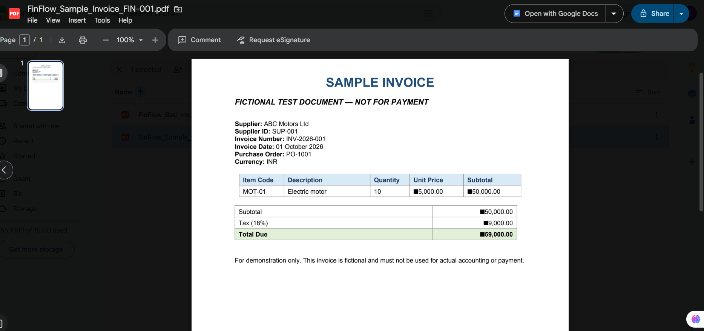

# FinFlow AI: Accounts Payable Invoice Intake Automation

> An AI-assisted workflow that reads supplier invoice PDFs, extracts the key fields, and records them in a tracking sheet. Each invoice is flagged `EXTRACTED` or `NEEDS_REVIEW`.


---

## Overview

In many finance teams, accounts payable staff open each supplier invoice, read it, and type the details into a spreadsheet by hand. This is slow and easy to get wrong.

**FinFlow AI** automates this first step. When an invoice PDF is added to a Google Drive folder, the workflow reads it with AI, pulls out the key fields, saves them to Google Sheets, and flags any invoice with missing data so a person can review it before payment.

The whole system runs on free tools and the free Gemini API tier.

## Demo

**Demo video:** [Watch the demo](finflow%20ai%20automation%20vedio.mp4)


## How It Works

```
Google Drive (Watch Files)
        |
   Filter: PDF only
        |
Google Drive (Download File)
        |
Gemini (Upload File)
        |
Gemini (Generate Response)  ->  extracts 9 invoice fields as JSON
        |
     Parse JSON
        |
Google Sheets (Add a Row)  ->  status: EXTRACTED / NEEDS_REVIEW
```


1. **Watch Files:** Make.com checks a Google Drive folder for new files every 15 minutes.
2. **Filter:** Only files with the MIME type `application/pdf` continue.
3. **Download and Upload:** The PDF is downloaded and sent to the Gemini Files API.
4. **AI Extraction:** Gemini reads the invoice and returns plain JSON. Missing values are returned as empty, never invented.
5. **Parse JSON:** The JSON is split into separate fields.
6. **Log to Sheets:** A new row is added to the `Intake_Log` sheet with all fields.
7. **Validation:** The status is set to `EXTRACTED` if the key fields are present, or `NEEDS_REVIEW` if any are missing.

## Extracted Fields

| Field | Example |
|---|---|
| Supplier name | ABC Motors Ltd |
| Supplier ID | SUP-001 |
| Invoice number | INV-2026-001 |
| Invoice date | 01 October 2026 |
| Purchase order | PO-1001 |
| Currency | INR |
| Subtotal | 50,000.00 |
| Tax | 9,000.00 |
| Total due | 59,000.00 |

Each row also stores the Drive file ID, file name, file link, MIME type, received time, processing status, and an error message column.

## Validation Logic

A row is marked **`NEEDS_REVIEW`** when the supplier name, invoice number, invoice date, or total due is missing. Otherwise it is marked **`EXTRACTED`**.

**Tested with two invoices:**

| Test | Result |
|---|---|
| Complete sample invoice | `EXTRACTED` |
| Invoice with no invoice number and no date | `NEEDS_REVIEW` |



## Tech Stack

- **Make.com:** workflow automation
- **Google Drive:** invoice storage
- **Google Gemini API (free tier):** invoice reading and field extraction
- **Google Sheets:** tracking log (`Intake_Log`)

## Skills Demonstrated

- Workflow automation design
- Prompt engineering for structured JSON output
- Data extraction from unstructured documents
- Data validation and exception flagging
- Debugging real integration issues (filters, file handling, JSON parsing)

## Current Limitations

- Tested on a small number of sample invoices. Real invoices vary in layout, so more testing is needed.
- Only PDF files are supported.
- No duplicate invoice detection yet.
- No automatic handling of AI or API failures yet.

## Roadmap

- [ ] Check that subtotal + tax equals total due
- [ ] Detect duplicate invoice numbers
- [ ] Error handling and a `FAILED` status
- [ ] Email notification for `NEEDS_REVIEW` invoices
- [ ] Support for scanned and image-based invoices

## Disclaimer

All invoices in this repository are fictional samples created for demonstration. No real financial data is used.

## Author

**Keerthana R**
B.E. Computer Science Engineering student, SRM TRP Engineering College, Tiruchirappalli
Interested in AI automation and data analytics

- GitHub: [keerthanatec26-tec](https://github.com/keerthanatec26-tec)
- LinkedIn: [keerthana-r-713098378](https://www.linkedin.com/in/keerthana-r-713098378)
